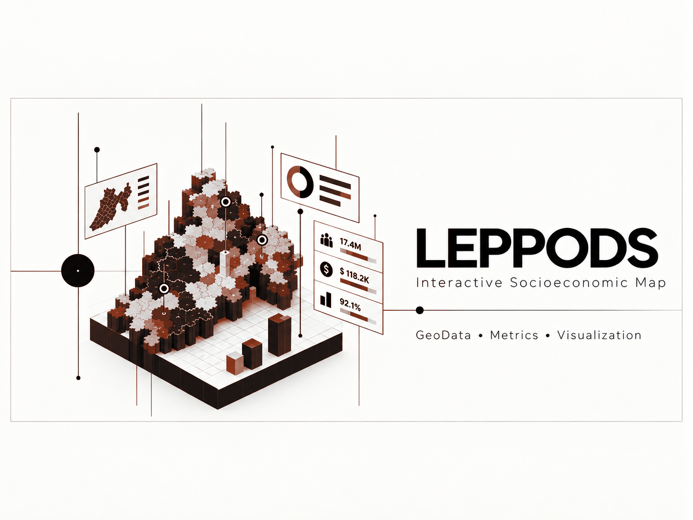

### An interactive socioeconomic mapping concept for exploring geographic indicators, comparisons, and regional patterns.

## Overview

LEPPODS combines geographic regions and socioeconomic indicators in an interactive map designed to make regional differences easier to explore and communicate.

## My Contributions

- Designed the map-centered analytical experience
- Connected regional geometry with indicator-driven views
- Structured metrics for comparison and filtering
- Focused the presentation on readable geographic context

## Project Highlights

- Interactive regional map
- Socioeconomic indicators
- Comparative metrics
- Geographic data visualization

## System Architecture

A geospatial presentation layer joins regional features to normalized indicator records and exposes them through interactive filters, summaries, and map-driven selection.

## Tech Stack

`GeoJSON` `Geospatial visualization` `JavaScript` `Interactive maps` `Data normalization` `Responsive UI`

## Results

- Turned regional datasets into an explorable visual format
- Made comparisons available directly from geographic selection
- Created a reusable foundation for additional indicators

## Screenshots

Additional sanitized product screenshots will be added when they can be shared without exposing private data or infrastructure.

## What I Learned

Good map interfaces balance statistical detail with spatial context and must communicate missing or incomparable values explicitly.

## Privacy and Ownership

> This repository documents the portfolio project. Original private data, internal services, and any restricted implementation details are not included.

## Contact

- [LinkedIn](https://www.linkedin.com/in/dev-ai-erick)
- [GitHub](https://github.com/DevDope)

---

This repository is maintained as a professional portfolio case study. No license to proprietary source code or private assets is granted.
